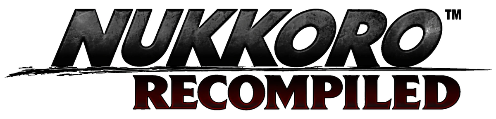
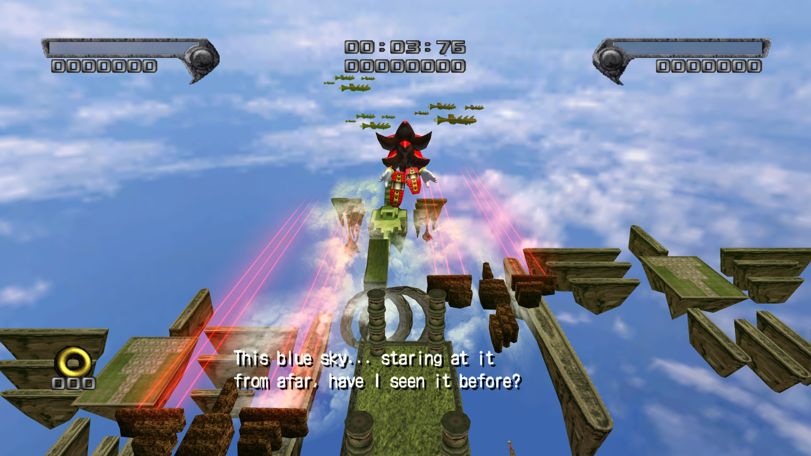
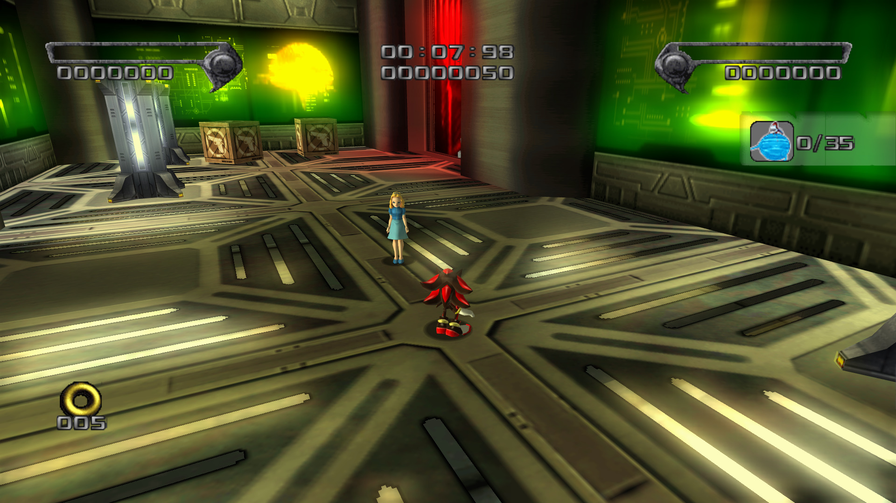
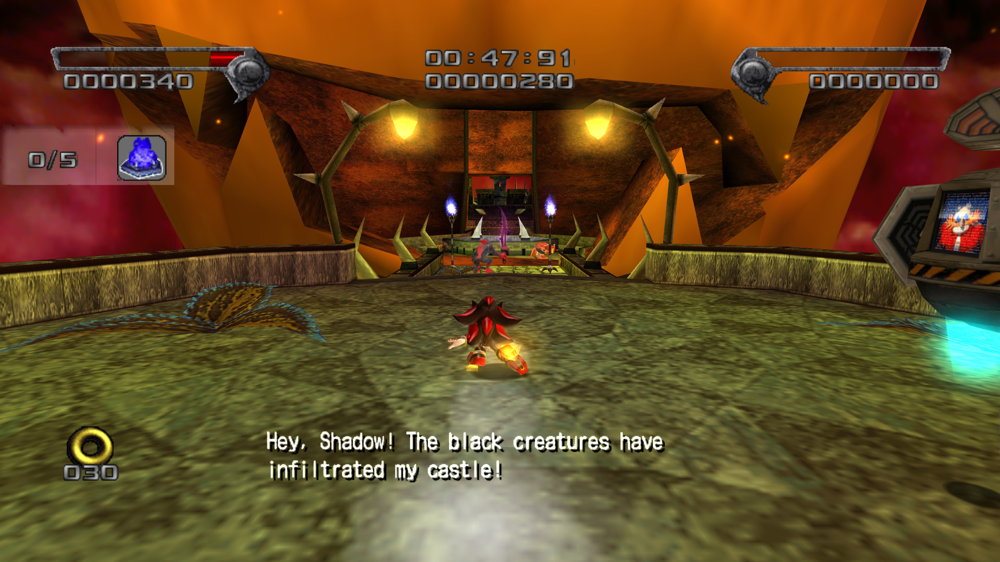
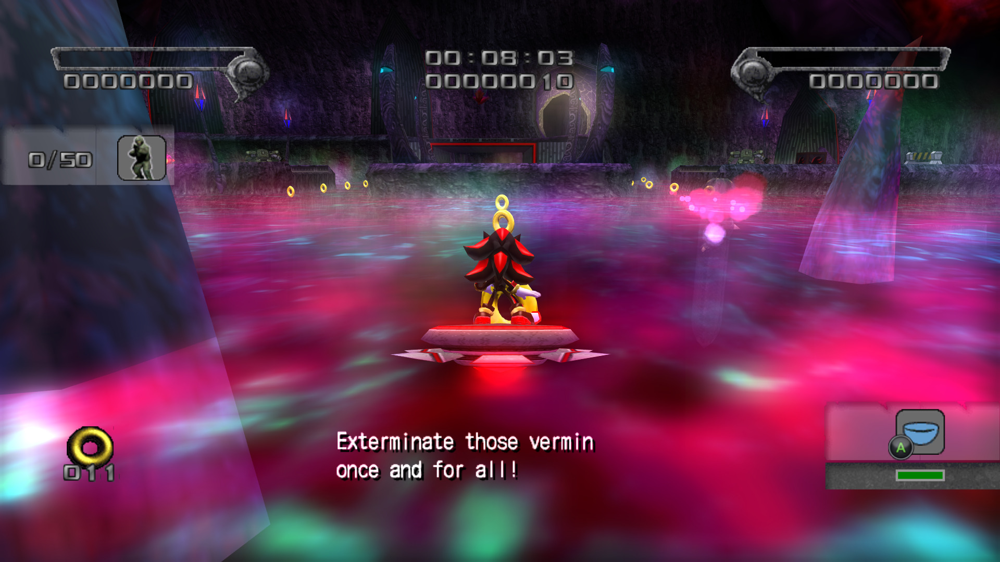
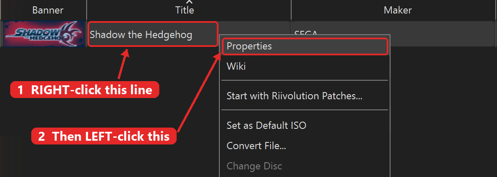
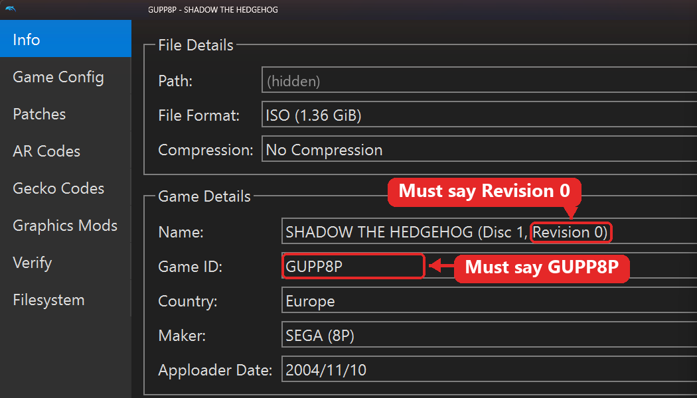
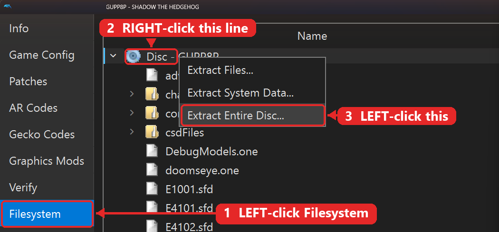
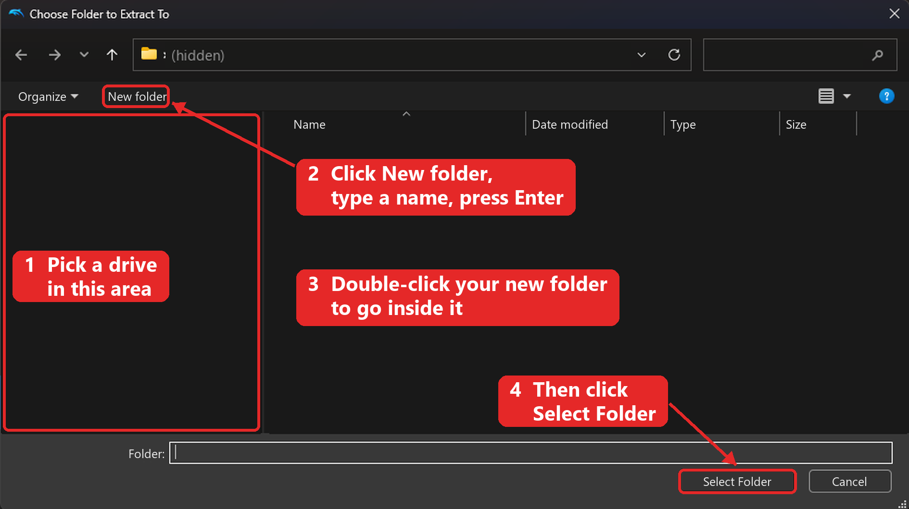

<p align="center">
    
</p>

---

A static recompilation of **Shadow the Hedgehog** (GameCube, PAL) for PC, made with GekkoForge and built from your own
copy of the game. It is still under development, so expect bugs and unfinished features.

## Screenshots

<p align="center">
    
    
    
    
</p>

## How it works

When you install it, GekkoForge translates the game's executable from your disc into C++ and compiles it for Windows.
Parts of the game have been replaced with PC code, one part at a time, and the rest is still static recompiled code.

You provide the game's executable and files from your own legally dumped disc. The install contains code built from
your disc, so please keep it to yourself.

## What you need

- Windows 10 or 11, 64-bit, with a Direct3D 12 graphics card
- Shadow the Hedgehog for GameCube, the **PAL** release (game ID **GUPP8P**), extracted with [Dolphin](https://dolphin-emu.org/)
- Optional, for Japanese voices: the **Japanese** release (game ID **GUPJ8P**), extracted into a different folder (see
  [Japanese voices](#japanese-voices))
- [Visual Studio 2026](https://visualstudio.microsoft.com/downloads/) with the *Desktop development with C++* workload
- [CMake](https://cmake.org/download/) 3.25 or newer
- [Python 3](https://www.python.org/downloads/)
- The Microsoft Edge WebView2 Runtime (included in Windows 11; on Windows 10 the setup offers the download)

## Install

1. In Dolphin, right-click the game and choose *Properties*. On the *Filesystem* tab, right-click the disc at the top and
   choose *Extract Entire Disc...*. [Extracting the disc](#extracting-the-disc) shows this with pictures.
2. Download `NukkoroRecomp-<version>-Setup.exe` from [Releases](https://github.com/ZenKazeX/NukkoroRecomp/releases) and run
   it. Windows may warn about an unknown publisher, because the file is unsigned. Choose *More info*, then *Run anyway*.
3. Choose the extracted disc folder, the install location and the shortcuts you want, then start the install. On the
   *Japanese Voices* page you can also choose an extracted Japanese disc, or leave it empty.

The first build takes about 5 to 20 minutes. Afterwards the extracted disc folder is no longer needed, and you can delete
the build files in `C:\Users\Public\NukkoroRecomp`. Running the setup again on the same folder updates the game and keeps
your saves.

From a copy of this repository, run `Install.cmd` instead. To install from a console:

```powershell
.\Install.cmd -DiscPath "D:\Dumps\Shadow PAL" -InstallPath "D:\Games\Shadow the Hedgehog Recompiled"
```

### Japanese voices

The PAL disc has the Japanese menu and subtitle text, but not the Japanese voices of the events (cutscenes) and dialogue.
Those are only on the Japanese disc. For the events to play in Japanese:

1. Extract your Japanese disc (GUPJ8P) with Dolphin the same way, into a **different folder** than the PAL disc.
2. Choose that folder on the setup's *Japanese Voices* page, and keep *Speak Japanese* ticked.

The setup checks the disc and copies only its voice files (about 470 MB) into the `voice_jp` folder of the install
folder; nothing else from the Japanese disc is used. To switch the spoken language later, set `voice` in `options.cfg`
(`0` Japanese, `1` English). To add the voices to an existing install, run the setup again with the Japanese disc
chosen; your saves and settings are kept. From a console:

```powershell
.\Install.cmd -DiscPath "D:\Dumps\Shadow PAL" -JapaneseDiscPath "D:\Dumps\Shadow JP" -InstallPath "D:\Games\Shadow the Hedgehog Recompiled"
```

### Extracting the disc

Follow the red numbers in each picture. Right-click means the right mouse button, and every other click is the left one.

1. In Dolphin's game list, right-click the European version of the game, which has the blue flag with yellow stars. Then
   click *Properties*.

   

2. On the *Info* page, check that the *Name* line ends with `Revision 0` and the *Game ID* line says `GUPP8P`. The setup
   refuses any other version.

   

3. Click *Filesystem*, right-click the *Disc* line at the very top of the list, then click *Extract Entire Disc...*.

   

4. Pick a drive, click *New folder*, type a name and press Enter. Double-click the new folder to go inside it, then click
   *Select Folder*. The picture hides the drives and folders, and you will see your own.

   

5. When the extraction has finished, check that the folder contains `sys` and `files`. This is the folder the setup asks
   for.

## Controller

Run `ShadowPadConfig.exe` in the install folder, or use the *Controller Buttons* shortcut in the Start menu. Click a
button on the picture, press the button you want on your controller, then Save. The game uses the new mapping the next
time it starts.

By default the face buttons follow their position on a modern controller. The GameCube pad's B is on the left button
(X on an Xbox controller) and its X is on the right button (B).

The game can also be played with keyboard and mouse. The keys and the mouse are set in `controls.cfg` in the install
folder; [docs/controls/KEYBOARD_MOUSE_BINDINGS.md](docs/controls/KEYBOARD_MOUSE_BINDINGS.md) lists the defaults and
every setting.

## Settings

The Options screen is the game's own. The window, the picture and the volumes are set in `display.cfg` and
`options.cfg` in the install folder; [docs/PC_SETTINGS_FILES.md](docs/PC_SETTINGS_FILES.md) describes every line.
Alt+Enter switches between a window and fullscreen.

## Mods

The game loads mods from the `mods` folder in the install folder. Mods that replace the game's files (models, stages,
textures, text, sounds, movies) and Dolphin texture packs work.

1. Run `ShadowModManager.exe` in the install folder, or use the *Mod Manager* shortcut in the Start menu.
2. Drop a downloaded mod (`.zip`, `.7z`, `.rar`, or a folder) on the window, or click *Install...*. The manager puts
   each file where the game expects it and says what it left out.
3. Tick the mods you want. The list's order is the priority: when two mods change the same file, the higher one wins,
   and the manager shows every such conflict.
4. Click *Play*, or start the game as usual.

Code patches (Gecko and Action Replay codes, patched `main.dol` files) are recognised and kept with the mod, but they
are not applied. Programs and save files in a download are never installed. To play without mods, switch off *Load
mods* in the manager, or start the game with `--no-mods`. `ShadowModManager.exe help` lists the command-line use, and
[docs/mods/DESIGN.md](docs/mods/DESIGN.md) describes the folder layout and the rules.

## Saves

Your settings and saves stay in the install folder. Existing GameCube saves from the PAL, North American and Japanese
releases can be imported with `--memory-card <file>` the first time you start the game.

## Uninstall

Run `Uninstall.cmd` in the install folder, or use the uninstall shortcut in the Start menu. It removes only what the
setup installed, the mod manager and the Japanese voices included, and keeps your saves, settings and mods. `Uninstall.cmd -RemoveSaves`
deletes those as well.

## Known limitations

- The game is still partly static recompiled code, and some features are unfinished.
- Only the PAL release can be installed.
- Mods made for the North American release may show its stage layouts or fonts; the manager points these out.

## For developers

`Build.cmd` builds from the repository after each edit. The first run asks for the extracted disc folder.

```powershell
.\Build.cmd                             # build
.\Build.cmd -Run --boot-stage stg0100   # build, then start the game
```

See [docs/BUILDING.md](docs/BUILDING.md) for presets, tests and what is and is not in this repository, and
[docs/RELEASE_VALIDATION.md](docs/RELEASE_VALIDATION.md) for what was tested in this release.

## Legal

Unofficial fan project, unaffiliated with SEGA and Nintendo. Shadow the Hedgehog is a trademark of SEGA. You must own
the game to use this project.
