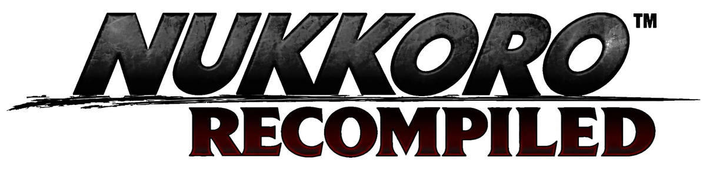
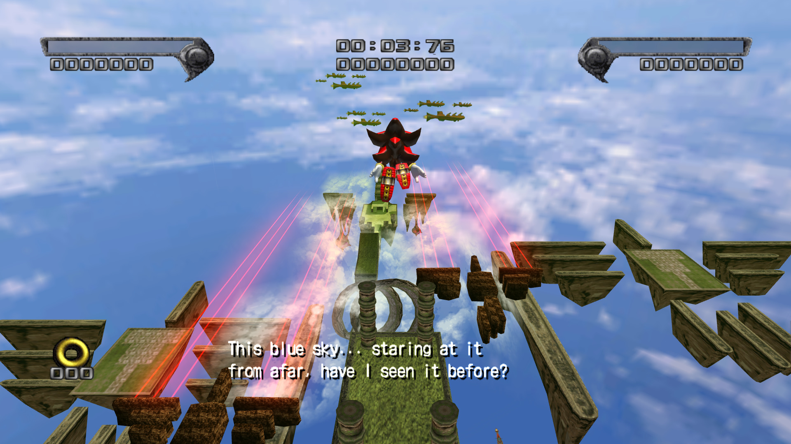
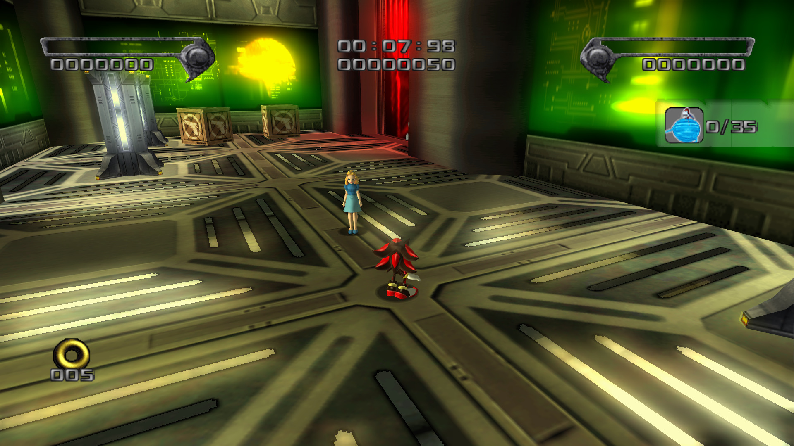
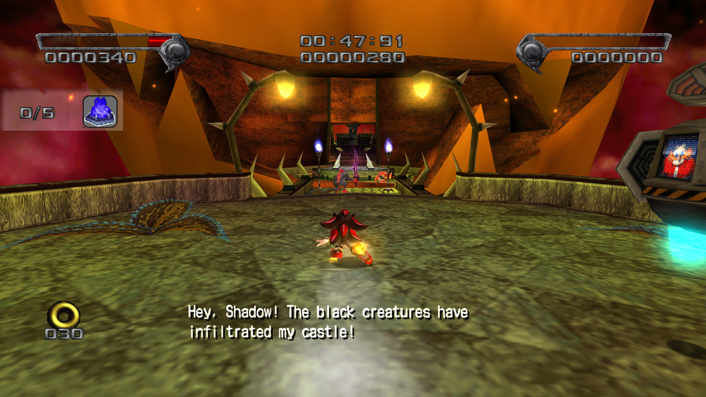
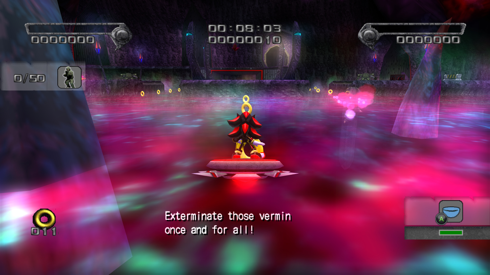
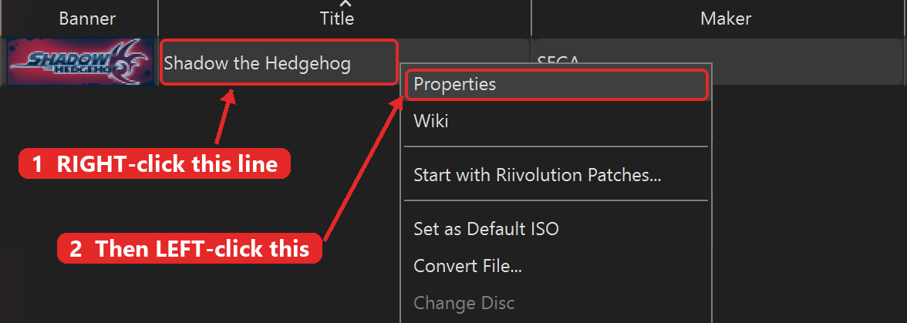
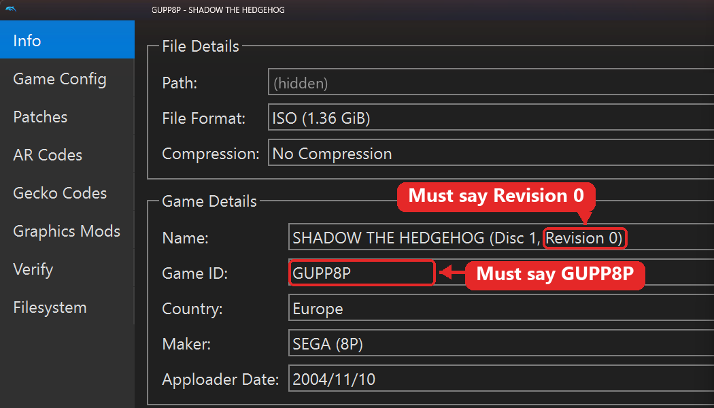
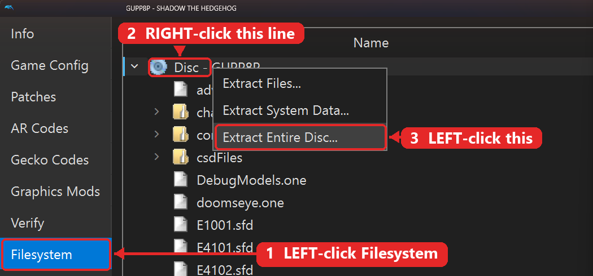
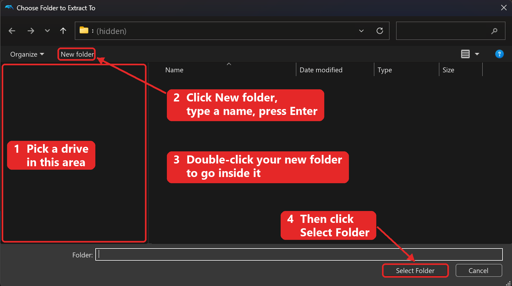

<p align="center">
    
</p>

---

A static recompilation of **Shadow the Hedgehog** (GameCube, PAL) for PC, made with GekkoForge and built from your own
copy of the game. It is still under development, so expect bugs and unfinished features.

## Screenshots

<p align="center">
    
    
    
    
</p>

## How it works

When you install it, GekkoForge translates the game's executable from your disc into C++ and compiles it for Windows.
Parts of the game have been replaced with PC code, one part at a time, and the rest is still static recompiled code.

You provide the game's executable and files from your own legally dumped disc. The install contains code built from
your disc, so please keep it to yourself.

## What you need

- Windows 10 or 11, 64-bit, with a Direct3D 12 graphics card
- Shadow the Hedgehog for GameCube, the **PAL** release (game ID **GUPP8P**), extracted with [Dolphin](https://dolphin-emu.org/)
- [Visual Studio 2026](https://visualstudio.microsoft.com/downloads/) with the *Desktop development with C++* workload
- [CMake](https://cmake.org/download/) 3.25 or newer
- [Python 3](https://www.python.org/downloads/)
- The Microsoft Edge WebView2 Runtime (included in Windows 11; on Windows 10 the setup offers the download)

## Install

1. In Dolphin, right-click the game and choose *Properties*. On the *Filesystem* tab, right-click the disc at the top and
   choose *Extract Entire Disc...*. [Extracting the disc](#extracting-the-disc) shows this with pictures.
2. Download `NukkoroRecomp-<version>-Setup.exe` from [Releases](https://github.com/ZenKazeX/NukkoroRecomp/releases) and run
   it. Windows may warn about an unknown publisher, because the file is unsigned. Choose *More info*, then *Run anyway*.
3. Choose the extracted disc folder, the install location and the shortcuts you want, then start the install.

The first build takes about 10 to 30 minutes. Afterwards the extracted disc folder is no longer needed, and you can delete
the build files in `C:\Users\Public\NukkoroRecomp`. Running the setup again on the same folder updates the game and keeps
your saves.

From a copy of this repository, run `Install.cmd` instead. To install from a console:

```powershell
.\Install.cmd -DiscPath "D:\Dumps\Shadow PAL" -InstallPath "D:\Games\Shadow the Hedgehog Recompiled"
```

### Extracting the disc

Follow the red numbers in each picture. Right-click means the right mouse button, and every other click is the left one.

1. In Dolphin's game list, right-click the European version of the game, which has the blue flag with yellow stars. Then
   click *Properties*.

   

2. On the *Info* page, check that the *Name* line ends with `Revision 0` and the *Game ID* line says `GUPP8P`. The setup
   refuses any other version.

   

3. Click *Filesystem*, right-click the *Disc* line at the very top of the list, then click *Extract Entire Disc...*.

   

4. Pick a drive, click *New folder*, type a name and press Enter. Double-click the new folder to go inside it, then click
   *Select Folder*. The picture hides the drives and folders, and you will see your own.

   

5. When the extraction has finished, check that the folder contains `sys` and `files`. This is the folder the setup asks
   for.

## Controller

Run `ShadowPadConfig.exe` in the install folder, or use the *Controller Buttons* shortcut in the Start menu. Click a
button on the picture, press the button you want on your controller, then Save. The game uses the new mapping the next
time it starts.

By default the face buttons follow their position on a modern controller. The GameCube pad's B is on the left button
(X on an Xbox controller) and its X is on the right button (B). Keyboard keys cannot be changed yet.

## Saves

Your settings and saves stay in the install folder. Existing GameCube saves from the PAL, North American and Japanese
releases can be imported with `--memory-card <file>` the first time you start the game.

## Uninstall

Run `Uninstall.cmd` in the install folder, or use the uninstall shortcut in the Start menu. It removes only what the
setup installed and keeps your saves and settings. `Uninstall.cmd -RemoveSaves` deletes those as well.

## Known limitations

- The game is still partly static recompiled code, and some features are unfinished.
- Only the PAL release can be installed.
- The Hungarian language is switched off for now.

## For developers

`Build.cmd` builds from the repository after each edit. The first run asks for the extracted disc folder.

```powershell
.\Build.cmd                             # build
.\Build.cmd -Run --boot-stage stg0100   # build, then start the game
```

See [docs/BUILDING.md](docs/BUILDING.md) for presets, tests and what is and is not in this repository, and
[docs/RELEASE_VALIDATION.md](docs/RELEASE_VALIDATION.md) for what was tested in this release.

## Legal

Unofficial fan project, unaffiliated with SEGA and Nintendo. Shadow the Hedgehog is a trademark of SEGA. You must own
the game to use this project.
