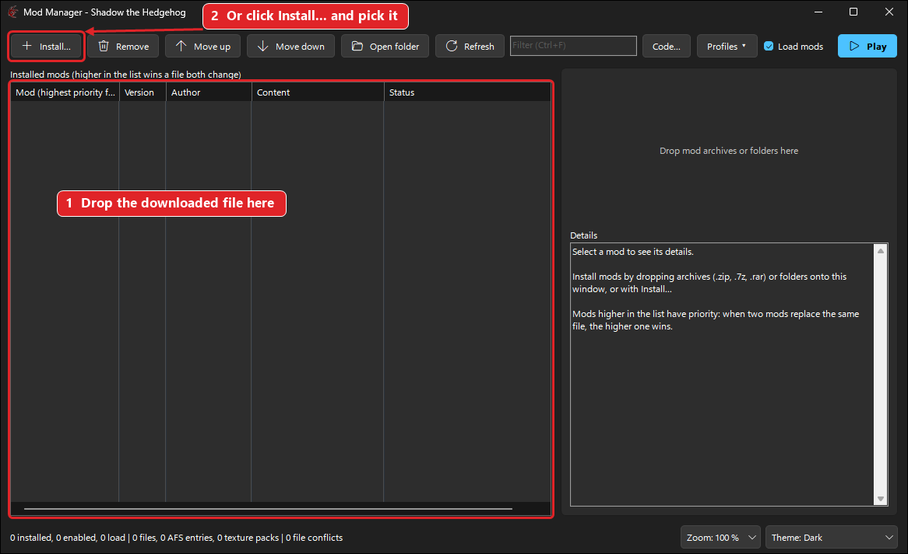
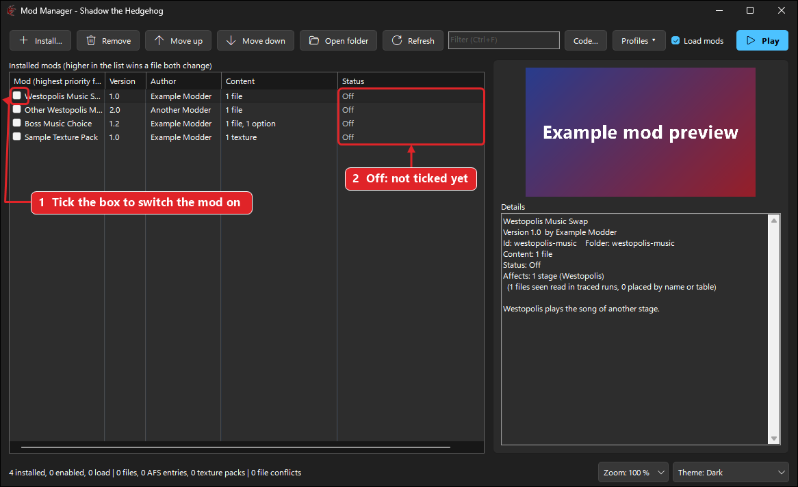
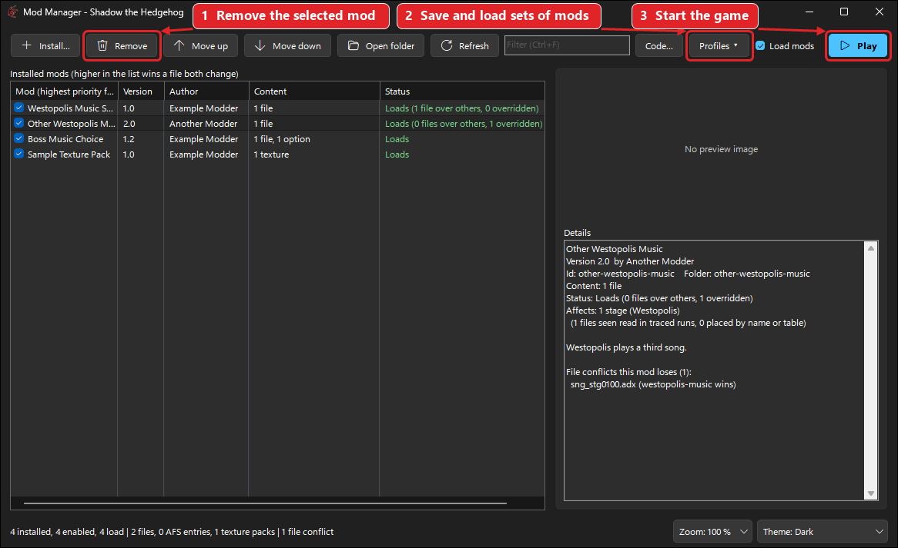
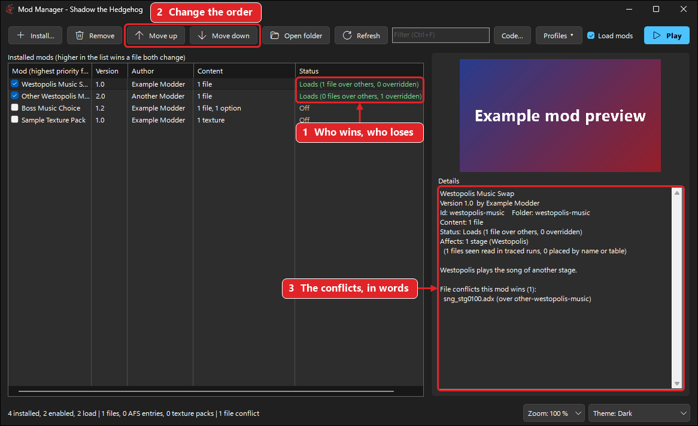
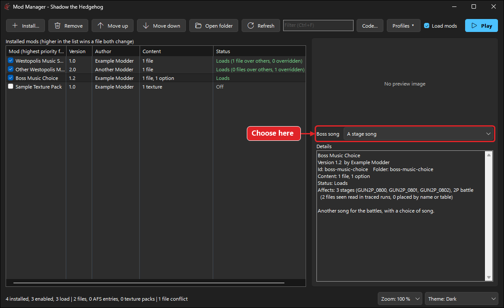
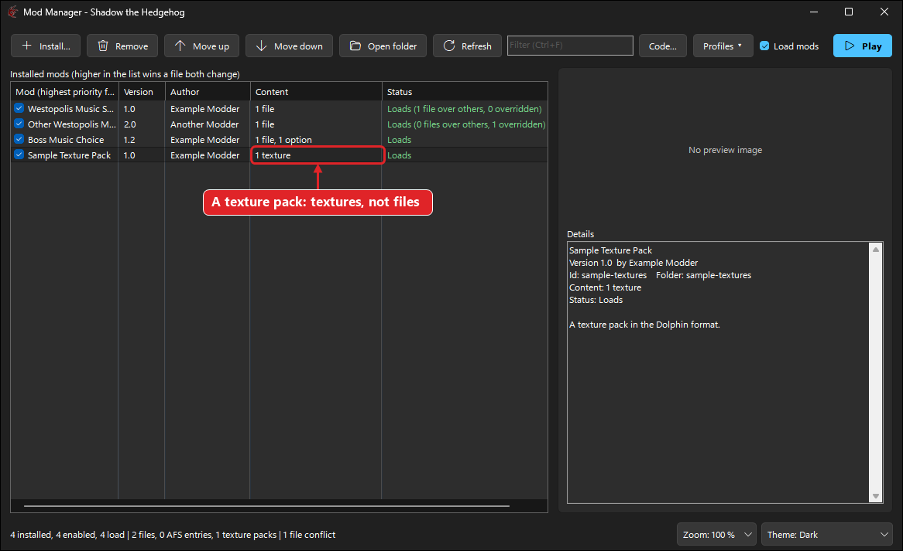
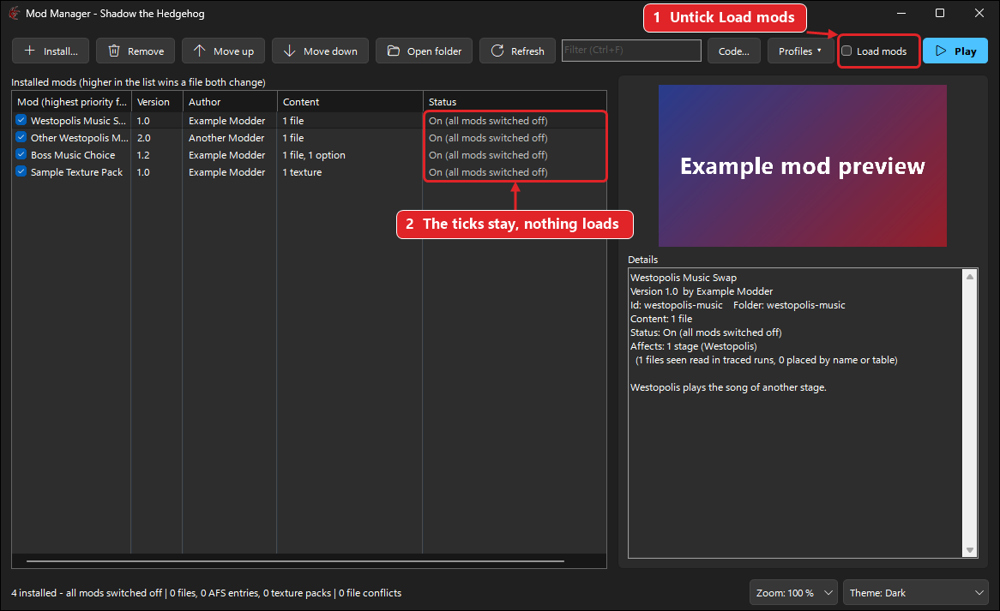

# Mod Manager tutorial

This tutorial shows, with pictures, how to add mods to the game with the *Mod Manager*, switch them on and off, and
take them out again. The mods in the pictures are small examples made for this tutorial; your list will show your own
downloads.

Mod support is **experimental**: many mods work, some only in part, and some kinds not at all. See
[What does not work](#what-does-not-work) before you start. The [Mods guide](MODS_GUIDE.md) has every detail.

Follow the red numbers in each picture. Every click is a click with the left mouse button, unless it says right-click.

## Contents

- [Open the Mod Manager](#open-the-mod-manager)
- [Install a mod](#install-a-mod)
- [Switch it on and play](#switch-it-on-and-play)
- [Two mods that change the same thing](#two-mods-that-change-the-same-thing)
- [Options of a mod](#options-of-a-mod)
- [Texture packs](#texture-packs)
- [Play without mods](#play-without-mods)
- [Profiles](#profiles)
- [Remove a mod](#remove-a-mod)
- [What does not work](#what-does-not-work)
- [If the game stops with an error](#if-the-game-stops-with-an-error)

## Open the Mod Manager

Open the Start menu and click *Mod Manager* in the game's folder there, or open the folder where you installed the game
and double-click `ModManager.exe`. Leave `ModManager.exe` in that folder: it needs the game's files beside it to know
where each file of a mod belongs.

Everything you do in the Mod Manager is kept at once. There is no Save button. The game reads its mods when it starts,
so a change shows the next time you start the game.

## Install a mod

1. Download the mod. You do not need to unpack it: `.zip`, `.7z` and `.rar` files work, and so do folders.

2. Drag the downloaded file from its folder onto the Mod Manager's window and let go (1). You can drop several at once.
   Or click *Install...* (2) and pick the file (this way takes files only; to install a folder, drop it).

   

3. Wait while the bar at the bottom runs. Then a message tells you what was installed, for example: *Installed "Some Mod"
   from somemod.zip: 12 files, 0 AFS entries, 3 textures. It is off until you tick it.* It also names anything the
   manager left out, and why.

You do not have to sort the files of a download yourself: the manager puts each file where the game expects it.

- **Updating a mod:** install the new download the same way. The manager sees that the mod is installed already and
  asks whether to replace it. Its place in the list, its tick and its options are kept.
- **A damaged download is refused**, and nothing is installed. Download it again.

## Switch it on and play

1. A new mod is at the bottom of the list and switched off: its *Status* says *Off* (2). Tick its box (1) to switch it
   on. The status turns green and says *Loads*.

   

   Click a mod's name to see it on the right: its picture (if it has one) and the *Details*, which say what the mod
   changes and where in the game.

   Other ways to switch a mod on or off: double-click its row, or select it and press Space, or right-click it and
   choose *Switch on* or *Switch off*. To switch every mod at once, right-click the list and choose *Switch all on* or
   *Switch all off*.

2. Click *Play* (3 in this picture), or start the game the usual way.

   

If the game is already running, close it and start it again: it reads the mods only when it starts.

Some mods need another mod. When you switch such a mod on, the manager offers to switch on what it needs too, and it
tells you if something it needs is not installed.

## Two mods that change the same thing

When two mods change the same file of the game, only one of them can win. The rule is simple: **the mod higher in the
list wins.**

1. Look at the *Status* column (1). Here the first mod says *Loads (1 file over others, 0 overridden)*: it wins one file.
   The second says *Loads (0 files over others, 1 overridden)*: it loses that file, so that part of it is not seen.

2. To let the other mod win, change the order: select a mod and click *Move up* or *Move down* (2). You can also drag
   a row up or down with the mouse, or press Alt and the Up or Down arrow.

3. The *Details* (3) say the same in words: which files the mod wins, and against which mod.

   

A conflict is not an error. It only tells you whose version of a file you will see. Put the mod you care about more
higher in the list.

## Options of a mod

Some mods come with choices, for example a widescreen and a 4:3 version. Click the mod: its options appear as lists
above the *Details*. Pick what you want. The choice is kept at once and used the next time the game starts.

When a download holds two versions of the same files, the manager makes an option of the extra version itself; that
option is off at first. The window shows up to six options per mod.

## Texture packs

A texture pack replaces pictures of the game (characters, objects, menus) with new ones. The game uses the same kind of
pack as the Dolphin emulator: picture files whose names start with `tex1_`. Do not rename them; the name tells the game
which picture they replace.

Install and tick a texture pack like any other mod. Its *Content* says how many textures it has.

When two packs replace the same picture, the higher one in the list wins, as with other mods. A few pictures of a pack
may not show: a picture is only replaced when the pack was made from exactly the same picture your game has. The
[Mods guide](MODS_GUIDE.md#texture-packs) says which picture formats work.

## Play without mods

To play the game without any mod, untick *Load mods* (1). Nothing is removed and the ticks stay: the mods' status says
*On (all mods switched off)* (2). Tick *Load mods* again to have them back.

This is also the quickest way to find out whether a problem comes from a mod or from the game.

## Profiles

A profile is a saved set: which mods are on, their order and their options. Click *Profiles* (2 in the picture under
[Switch it on and play](#switch-it-on-and-play)):

- **Save current set as...** asks for a name (1 to 40 letters, digits, spaces and `-` `_` `(` `)` `.`) and keeps the
  set under it.
- **Load "name"** switches to that set. The manager asks first, because your current choices are replaced.
- **Delete** lists the profiles; click one to delete it. This does not remove any mod.

## Remove a mod

1. Click the mod in the list.
2. Click *Remove* (1 in the picture under [Switch it on and play](#switch-it-on-and-play)), or press Delete, or
   right-click the mod and choose *Remove...*.
3. The manager asks "Remove ...? Its folder is moved to the Recycle Bin". Click *Yes*.

The mod goes to the Windows **Recycle Bin**. If you removed it by mistake, restore it from the Recycle Bin and click
*Refresh* in the Mod Manager. If you only want to stop using a mod for a while, untick it instead.

## What does not work

- **Code patches** (Gecko codes, Action Replay codes, changed `main.dol` files) are recognised and kept with the mod,
  but installing or ticking the mod does **not** apply them. A mod that is mostly code (new moves, new rules, new game
  modes) will be missing those parts. The *Code...* button is for people who build the game from its source code; leave
  it alone otherwise.
- **Patches for a whole disc image** (such as `.xdelta` files) are never applied. If the same mod is also offered as
  loose files, install those.
- **Programs** in a download are never run or installed. A download that is only a program is refused.
- **Save files** in a download are never installed, and the manager never touches your saves. A download that is only a
  save is refused. Saves made with a modded game on a console or emulator cannot be used.
- Mods made for the North American release mostly work, because the game is the European release and most files are the
  same. A few stage layouts and texts differ; the manager points those out in the *Details* and colours the status
  orange when a mod brings back North American stage layouts.

## If the game stops with an error

If a mod does not fit this game, or many mods together need more than the game can hold, the game can stop. It then
closes with the message "Shadow the Hedgehog stopped because of an error in the game", says how many mods are switched
on, and asks you to switch off some mods (or untick *Load mods*) and start again.

About memory: the original console had 24 MiB of memory, and new models and stages are often larger than the game's
own. So when any switched-on mod replaces game files, the game is given 256 MiB for that run. Without mods, or with
texture packs only, it runs exactly as before. A very large set of mods can still be too much; switch some off.

If the game also stops without any mod, please report it and attach the file `session-report.json` from the game's
folder. The [Mods guide](MODS_GUIDE.md#troubleshooting) has more answers.
