# Settings tutorial

This tutorial walks you through the *Settings* program, one page at a time, with pictures. It is where you set the
screen, the frame rate, the sound, the language, your controller, the keyboard and mouse, and autosave. The game's own
Options screen is still there; this program has everything a PC adds.

Follow the red numbers in each picture. Every click is a click with the left mouse button. The
[Settings guide](SETTINGS_GUIDE.md) has the same settings in tables, with the names of the files they are kept in.

## Contents

- [Open the program](#open-the-program)
- [Change a setting and save it](#change-a-setting-and-save-it)
- [Display](#display)
- [Frame rate](#frame-rate)
- [Sound](#sound)
- [Language](#language)
- [Controller buttons](#controller-buttons)
- [Controller options](#controller-options)
- [Keyboard and mouse](#keyboard-and-mouse)
- [Saving](#saving)
- [Zoom and theme](#zoom-and-theme)

## Open the program

1. Open the Start menu and click *Settings* in the game's folder there, or open the folder where you installed the game
   and double-click `Settings.exe`. The window is called *Settings - Shadow the Hedgehog*.

2. The window has four parts. The list of pages (1) is on the left: click a page to open it. Under it are the *Zoom* and
   *Theme* lists (2), which change how this program looks, not the game. At the bottom, a line (3) tells you what is
   going on, and the buttons (4) are *Restore defaults*, *Save* and *Close*.

   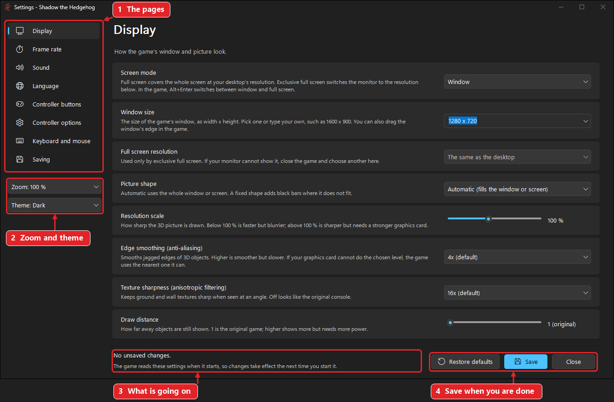

## Change a setting and save it

The game reads its settings when it starts. So the order is always: change, *Save*, then start the game (or close it
and start it again).

1. Change a setting, for example switch *Smooth motion* on (1). The line at the bottom now says "You have unsaved
   changes. Click Save to keep them." (2). Nothing is kept yet.

   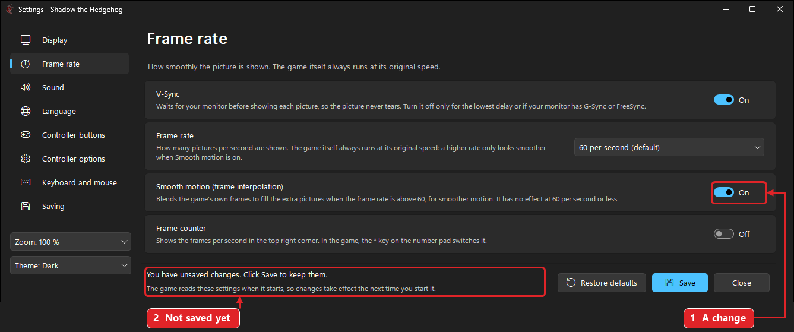

2. Click *Save* (1). The line now says "Saved. The game uses the new settings the next time it starts." (2).

   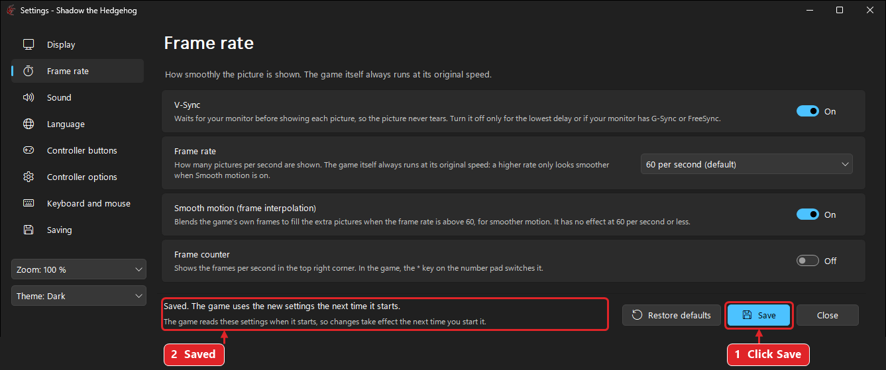

Good to know:

- *Save* keeps the changes of all pages at once, not only the page you are looking at.
- *Restore defaults* puts only the page you are looking at back to the game's defaults. It does not save: click *Save*
  afterwards to keep the defaults.
- If you click *Close* with unsaved changes, the program asks "Save your changes before closing?". *Yes* saves and
  closes, *No* closes and forgets the changes, *Cancel* keeps the window open. This is also the way to undo: close and
  answer *No*.
- You can leave the game running while you use the program. The line under the status line then says that the game is
  running and that it uses the new settings the next time it starts.
- If a value cannot be used (for example a window size you typed that is too small), the line at the bottom says what
  is wrong and that nothing was saved. Fix the value and click *Save* again.

## Display

How the game's window and picture look.

1. Click *Display*.

   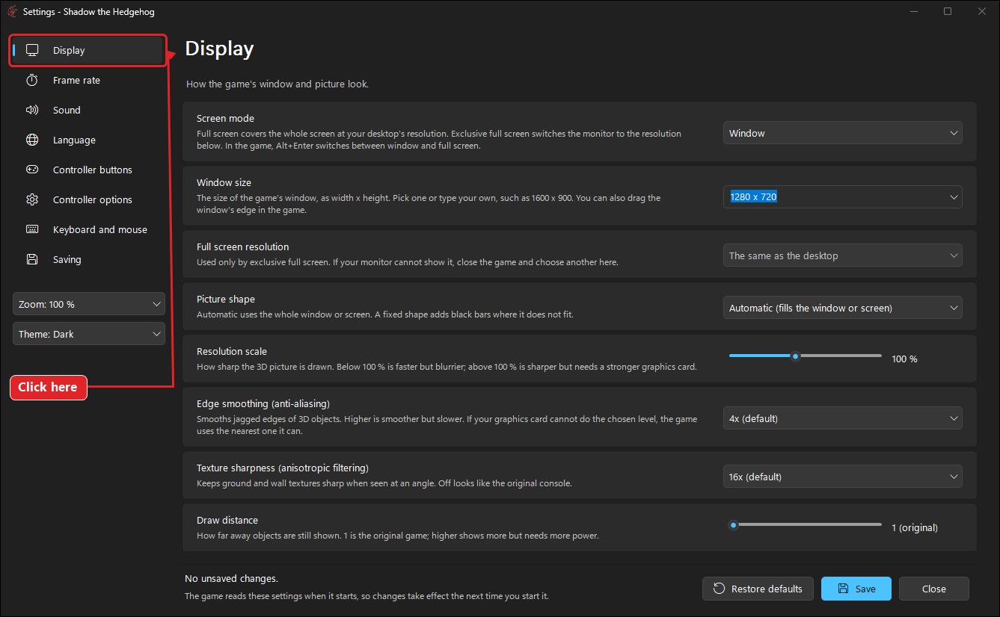

| Setting | What it does |
|---|---|
| **Screen mode** | *Window* shows the game in a window. *Full screen* covers the whole screen at the size your desktop uses. *Exclusive full screen* switches the monitor to the size you pick under *Full screen resolution*. In the game, Alt+Enter switches between window and full screen. |
| **Window size** | The size of the game's window. Pick one from the list, or type your own, such as `1600 x 900` (at least 320 x 240). You can also drag the window's edge in the game. The usual size is 1280 x 720. |
| **Full screen resolution** | Only for *Exclusive full screen* (it is greyed out otherwise). "The same as the desktop", or one of the sizes your monitor offers. If your monitor cannot show the size you chose, close the game and choose another one here. |
| **Picture shape** | *Automatic* fills the whole window or screen. A fixed shape (4:3 is the original game, then 5:4, 16:10, 16:9, 21:9, 32:10, 32:9) keeps that shape and adds black bars where it does not fit. |
| **Resolution scale** | How sharp the 3D picture is. Below 100 % is faster but blurrier, above 100 % (up to 200 %) is sharper but needs a stronger graphics card. |
| **Edge smoothing (anti-aliasing)** | Smooths the jagged edges of 3D objects: Off, 2x, 4x (the usual), 8x, 16x, 32x. Higher is smoother but slower. If your graphics card cannot do the level you chose, the game uses the nearest one it can. |
| **Texture sharpness (anisotropic filtering)** | Keeps the ground and walls sharp when you see them at an angle: Off, 2x, 4x, 8x, 16x (the usual). *Off* looks like the original console. |
| **Draw distance** | How far away objects are still shown, from 1 (the original game) to 8. Higher shows more but needs more power. |

## Frame rate

How smoothly the picture is shown. The game itself always runs at its original speed, whatever you choose here.

1. Click *Frame rate*.

   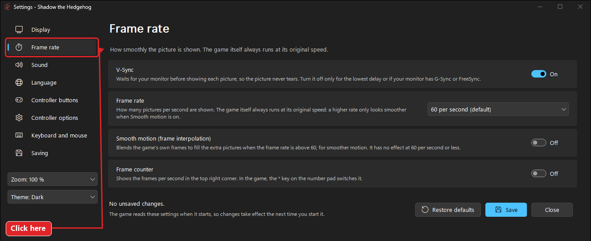

| Setting | What it does |
|---|---|
| **V-Sync** | Waits for your monitor before showing each picture, so the picture never tears (a line across the picture where two pictures meet). Switch it off only for the lowest delay, or if your monitor has G-Sync or FreeSync. On at first. |
| **Frame rate** | How many pictures per second are shown: 30, 60 (the usual), 75, 90, 120, 144, 165, 240, 360, or Unlimited. |
| **Smooth motion (frame interpolation)** | Fills the extra pictures above 60 per second by blending the game's own pictures. It does nothing at 60 per second or less. Off at first. |
| **Frame counter** | Shows the pictures per second in the top right corner of the game. In the game, the `*` key on the number pad switches it on and off. |

For smoother motion on a fast monitor, choose a frame rate above 60 **and** switch *Smooth motion* on. One without the
other does not make the motion smoother.

## Sound

The volume of each kind of sound.

1. Click *Sound*.

   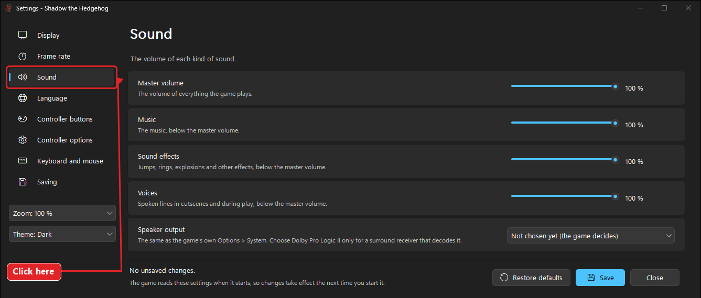

| Setting | What it does |
|---|---|
| **Master volume** | The volume of everything the game plays, from 0 % to 100 %. |
| **Music** | The music, below the master volume. |
| **Sound effects** | Jumps, rings, explosions and other effects, below the master volume. |
| **Voices** | Spoken lines in cutscenes and during play, below the master volume. |
| **Speaker output** | The same as the game's own *Options > System*: Stereo, Mono or Dolby Pro Logic II. Choose Dolby Pro Logic II only if you have a surround receiver that decodes it. |

"Not chosen yet (the game decides)" means that you have not chosen this here, so the game uses its own setting. You will
see this choice on a few other pages too.

## Language

Voices, subtitles and the language of the game's text.

1. Click *Language*.

   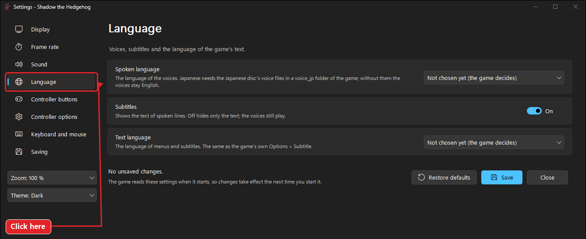

| Setting | What it does |
|---|---|
| **Spoken language** | English or Japanese voices. Japanese needs the voices of the Japanese disc, which the setup can copy (see *Japanese voices* in the [README](../README.md#japanese-voices)). Without them the voices stay English. |
| **Subtitles** | Shows the words of the spoken lines. *Off* hides only the words; the voices still play. |
| **Text language** | The language of the menus and subtitles: English, French, German, Italian, Spanish or Japanese. The same as the game's own *Options > Subtitle*. |

## Controller buttons

Which button on your controller presses which button of the game. The game was made for the GameCube controller, so
the page uses the GameCube's buttons: A, B, X, Y, Start, L, R, Z and the D-Pad.

1. Click *Controller buttons*. The list shows each game button and the button of your controller that presses it. The
   picture shows the same on a GameCube controller, from above and tilted (so you can see the shoulder buttons).

   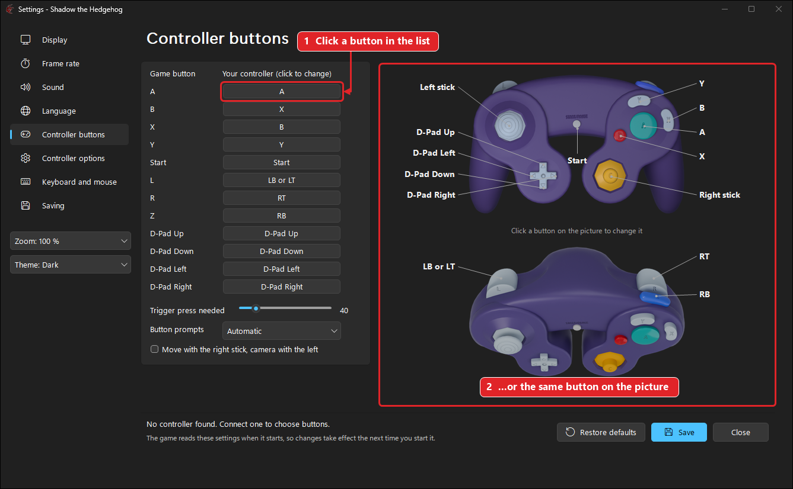

2. Connect your controller. The line at the bottom says "Controller connected. Click a button on the picture or in the
   list to change it." (Without a controller it says "No controller found", as in the picture.) Hold a button on your
   controller to check it: a dot appears beside its row, and the picture moves with your sticks.

3. Click the game button you want to change: its button in the list (1), or the same button on the picture (2).

4. The row now says "Press a button..." (1), the button lights up on the picture, and the line at the bottom asks you
   to press it (2). Press the button you want on your controller. You have about six seconds.

   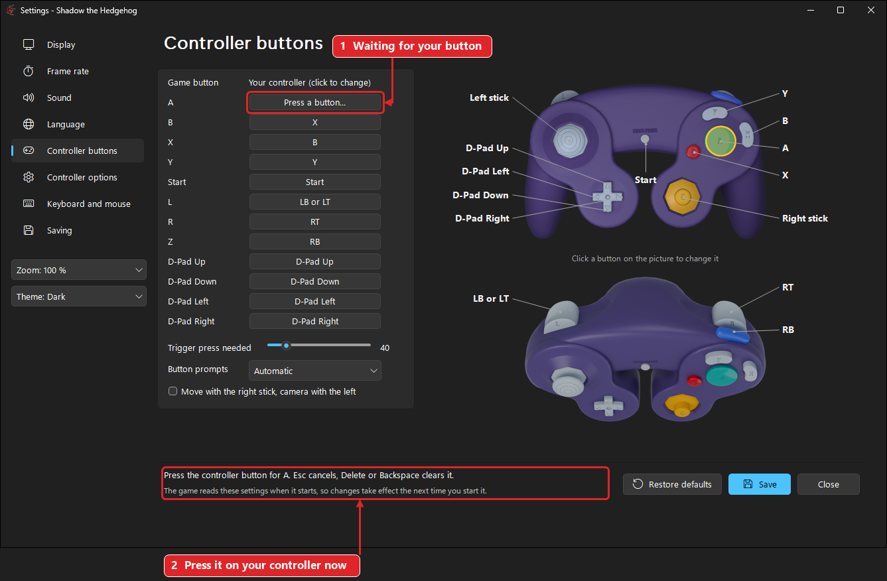

   While it waits: **Esc** cancels, and **Delete** (or Backspace) clears that game button, so that no button presses it
   ("Not set").

5. Click *Save*.

Good to know:

- At the start, the face buttons follow their *place* on a modern controller: the GameCube's B is on the left button
  (X on an Xbox controller) and its X is on the right button (B).
- The two triggers always work as the game's L and R. That is why the L row says "LB or LT".
- One controller button does one job. If you choose a button that another game button had, the two swap, so no game
  button is left without a button by accident.

Under the list are three more settings:

| Setting | What it does |
|---|---|
| **Trigger press needed** | How far you have to press a trigger before it counts as L or R, from 0 to 255. A low number reacts to a light press. 40 at first. |
| **Button prompts** | Which controller's buttons the game shows in its prompts: *Automatic* (follows the controller that is connected), *Original (GameCube)*, *Xbox*, *PlayStation* or *Nintendo Switch*. |
| **Move with the right stick, camera with the left** | Swaps the two sticks. The labels on the picture swap with them. |

## Controller options

Rumble and the camera stick.

1. Click *Controller options*.

   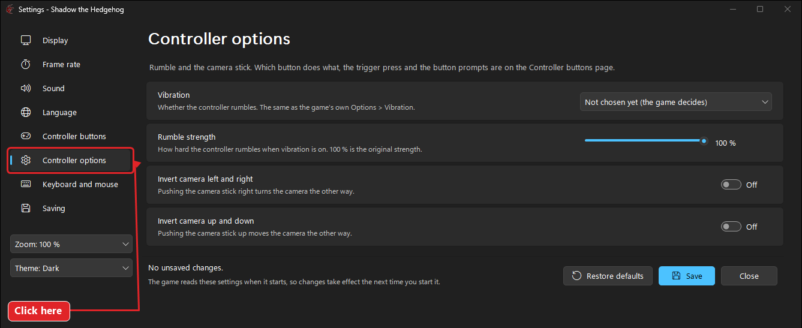

| Setting | What it does |
|---|---|
| **Vibration** | Whether the controller rumbles: On or Off. The same as the game's own *Options > Vibration*. |
| **Rumble strength** | How hard the controller rumbles when vibration is on, from 25 % to 100 % (the original strength). |
| **Invert camera left and right** | Pushing the camera stick right turns the camera the other way. |
| **Invert camera up and down** | Pushing the camera stick up moves the camera the other way. |

These two are for the controller's camera stick. The mouse has its own choices on the *Keyboard and mouse* page.

## Keyboard and mouse

The game can be played with a keyboard and mouse.

1. Click *Keyboard and mouse*. Each row is one action. It has three boxes, so an action can have up to three keys or
   mouse buttons. A box that shows "-" is empty. The letters in brackets, such as *Jump (A)*, are the game's own buttons,
   so you can match them with the prompts the game shows.

   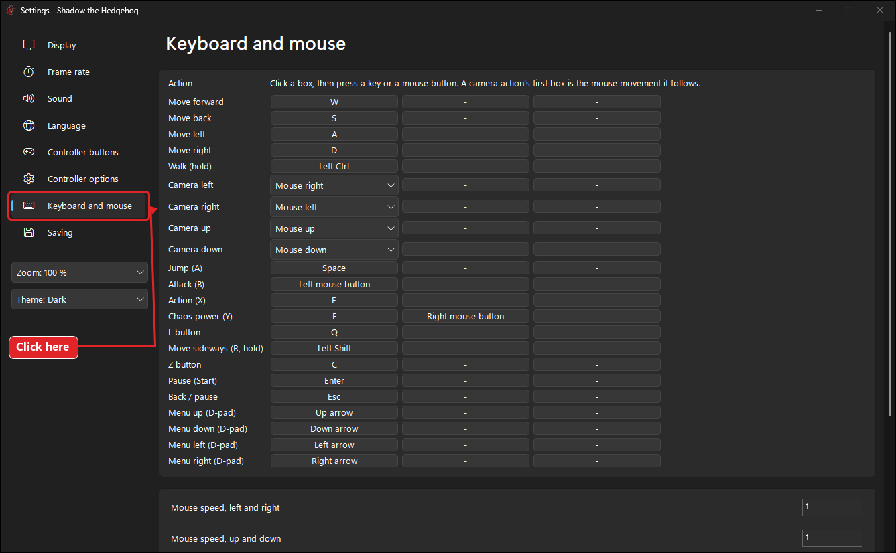

2. To change a key, click a box. It says "Press a key..." (1). Press the key or the mouse button you want; you have
   about six seconds. The left, right and middle mouse buttons and the two side buttons of a mouse work too, and left
   and right Shift, Ctrl and Alt are different keys.

   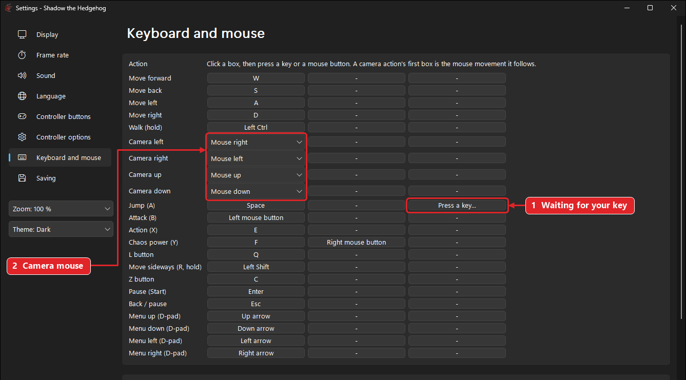

   While the box waits: **Delete** empties the box. To cancel, wait a few seconds. Every other key is taken as your
   choice, Esc included.

3. If the key is used by another action too, the line at the bottom tells you, for example "E is also used for: Action
   (X). Both will happen when you press it." Empty one of the two boxes if you do not want that.

4. Click *Save*. The game also picks up keyboard and mouse changes when you switch back to it while it is running.

**Which way the mouse turns the camera (2 in the picture above).** The first box of each *Camera* row is a list, not a
key: it chooses the mouse movement that turns the camera that way (*Mouse left*, *Mouse right*, *Mouse up*, *Mouse down*
or *No mouse*). The other two boxes of a camera row are keys, empty at first, for turning the camera from the keyboard.

- The camera turns the wrong way sideways: choose *Mouse left* in the *Camera left* row and *Mouse right* in the
  *Camera right* row.
- The camera goes the wrong way up and down: choose *Mouse down* in the *Camera up* row and *Mouse up* in the *Camera
  down* row.
- You do not want the mouse to move the camera one way: choose *No mouse* in that row.

At the start *Camera left* follows the mouse moving right. That is not a mistake: in this game "camera left" swings the
camera round to Shadow's left, which turns the view to the right, so the view follows your hand.

**The mouse settings** are under the table. Scroll down to see them.

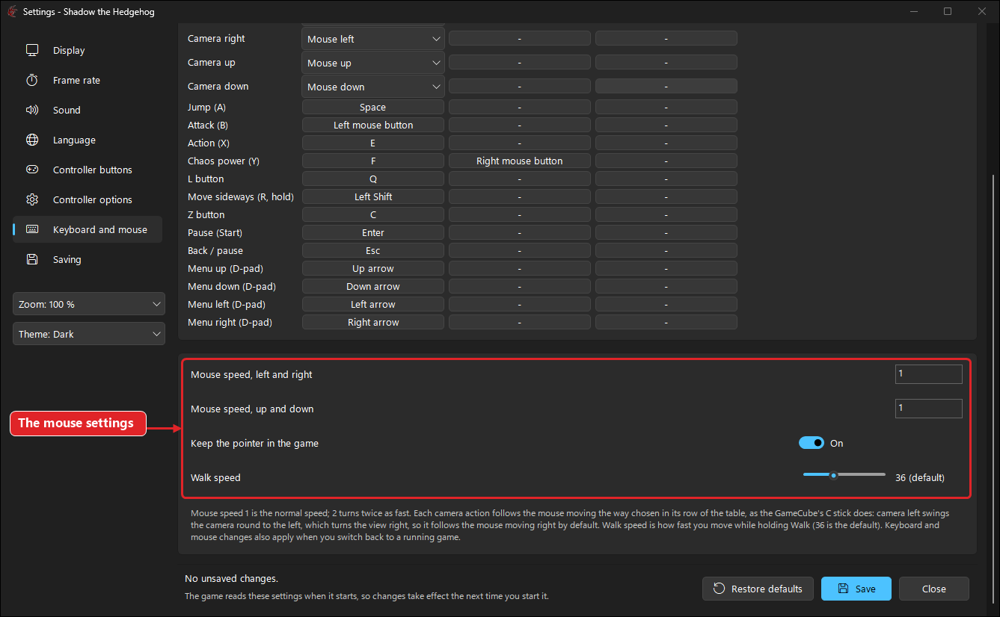

| Setting | What it does |
|---|---|
| **Mouse speed, left and right** | How fast the camera turns sideways when you move the mouse. 1 is the normal speed, 2 turns twice as fast. Type a number from 0.01 to 50, such as 1.5. |
| **Mouse speed, up and down** | The same for moving the mouse up and down. |
| **Keep the pointer in the game** | Hides the mouse pointer and keeps it inside the game while you play. On at first. |
| **Walk speed** | How fast Shadow moves while you hold the *Walk* key, from 1 to 100. 36 at first. |

## Saving

Whether the game saves your progress by itself.

1. Click *Saving*.

   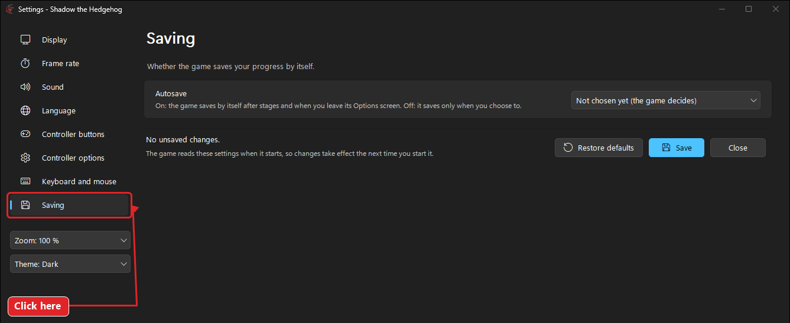

| Setting | What it does |
|---|---|
| **Autosave** | *On*: the game saves by itself after stages and when you leave its Options screen. *Off*: it saves only when you choose to. |

## Zoom and theme

The *Zoom* and *Theme* lists under the list of pages change how the Settings program looks. They do not change the game,
and they are used at once, without *Save*. The Mod Manager uses the same choice.

- **Zoom** makes the words larger: 100 %, 125 %, 150 %, 175 % or 200 %. You can also hold Ctrl and press + or -, or hold
  Ctrl and turn the mouse wheel; Ctrl and 0 goes back to 100 %. The window keeps its size: the page rearranges itself
  and you scroll it. In a small window, the list of pages shows only its pictures, and *Zoom* and *Theme* move to the
  bottom of the page.
- **Theme** changes the colours: *Same as Windows* (light or dark, as Windows is set; the usual), *Light*, *Dark*, or
  *Shadow*, which is black and red.

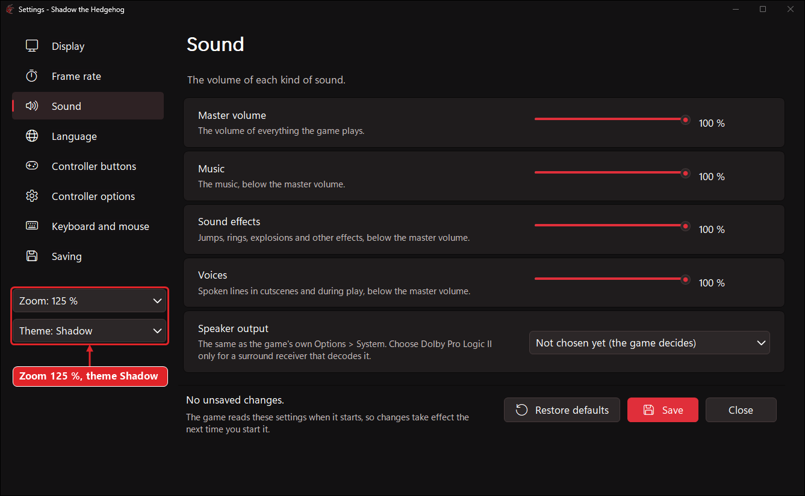

If something does not look right, the [Settings guide](SETTINGS_GUIDE.md#if-something-looks-wrong) has answers to the
usual questions.
